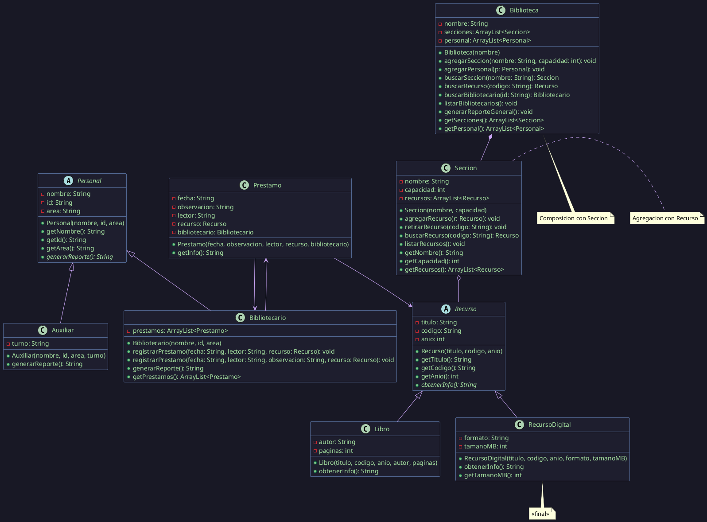

# Proyecto Final: Programación Orientada a Objetos
## Sistema de Gestión de Biblioteca Universitaria
**Equipos:** 2 o 3 personas · **Plazo:** 1 semana · **Entrega:** Código fuente + diagrama de clases

---

## Contexto

La biblioteca de una universidad necesita un sistema para administrar sus secciones, registrar recursos (libros físicos y recursos digitales), organizar a su personal y llevar el control de los préstamos. Tu equipo debe diseñar e implementar este sistema aplicando todos los principios de la Programación Orientada a Objetos vistos durante el curso.

El sistema debe funcionar desde consola con un menú interactivo y manejar correctamente los errores que puedan ocurrir en tiempo de ejecución.

---

## Diagrama de clases requerido



> **Cómo generar el diagrama:**
> 1. Copia el bloque entre ` ```plantuml ` y ` ``` `
> 2. Ve a [plantuml.com/plantuml](https://www.plantuml.com/plantuml/uml/) y pégalo
> 3. Descarga la imagen SVG o PNG
> 4. En tu `.md` incorpórala así: ``
>
> **Alternativa VS Code:** instala la extensión *PlantUML* de jebbs y presiona `Alt+D` para previsualizar.

---

## Estructura de paquetes requerida

```
SistemaBiblioteca/
└── src/
    ├── com/biblioteca/modelo/
    │   ├── Personal.java            ← abstracta
    │   ├── Bibliotecario.java
    │   ├── Auxiliar.java
    │   ├── Recurso.java             ← abstracta
    │   ├── Libro.java
    │   ├── RecursoDigital.java      ← final
    │   ├── Prestamo.java
    │   ├── Seccion.java
    │   ├── Biblioteca.java
    │   └── Validador.java           ← utilidad de validación de datos
    ├── com/biblioteca/excepciones/
    │   ├── SeccionLlenaException.java
    │   ├── RecursoNoEncontradoException.java
    │   ├── PersonalNoEncontradoException.java
    │   └── PrestamoInvalidoException.java
    └── com/biblioteca/app/
        └── App.java
```

> **Nota:** ¿Una sección guarda libros o recursos digitales? **Ambos.** `Seccion` trabaja con `ArrayList<Recurso>` (el tipo abstracto) para poder guardar cualquier subtipo sin distinguirlos. Eso es lo que permite el **polimorfismo**: la sección no necesita saber de qué tipo es cada recurso para gestionarlo.

---

## Especificación de clases

### Paquete `com.biblioteca.excepciones`

Crea primero las cuatro excepciones. Todas extienden `Exception`.

| Excepción | Constructor recibe | Mensaje que pasa a `super(...)` |
|---|---|---|
| `SeccionLlenaException` | `mensaje` | el mensaje recibido |
| `RecursoNoEncontradoException` | `codigo` | `"Recurso con código " + codigo + " no encontrado."` |
| `PersonalNoEncontradoException` | `id` | `"No existe personal registrado con id " + id + "."` |
| `PrestamoInvalidoException` | `mensaje` | el mensaje recibido |

---

### Paquete `com.biblioteca.modelo`

#### Clase de utilidad `Validador`

Métodos **estáticos** que evitan repetir validaciones en varias clases.

```
PSEUDOCÓDIGO:
  Método estático validarNombre(nombre):
    SI nombre es nulo o vacío ENTONCES
      lanzar IllegalArgumentException("El nombre no puede estar vacío.")
    SI nombre contiene algún dígito (0-9) ENTONCES
      lanzar IllegalArgumentException("El nombre no puede contener números: " + nombre)

  Método estático validarCodigo(codigo):
    SI codigo es nulo, vacío o contiene espacios ENTONCES
      lanzar IllegalArgumentException("Código inválido: no puede ser vacío ni tener espacios.")
```

> `validarNombre` se usa al inicio del constructor de `Personal`. `validarCodigo` se usa al inicio del constructor de `Recurso`.

#### Clase abstracta `Personal`

Atributos `private`: `nombre`, `id`, `area` (String).

```
Constructor:
  Llama Validador.validarNombre(nombre)
  Asigna nombre, id, area
```
Métodos: getters de los tres atributos y `generarReporte()` **abstracto**.

#### Clase `Bibliotecario` extiende `Personal`

Atributo `private`: `prestamos` (ArrayList\<Prestamo\>), inicializado vacío en el constructor.

> ⚠ El préstamo debe quedar asociado a un recurso **real**, no a `null`. La clase `App` pide el código, lo busca con `biblioteca.buscarRecurso(codigo)` y pasa el objeto encontrado.

`registrarPrestamo(fecha, lector, recurso)` *(primera versión, SOBRECARGA)*
```
  SI fecha es nula o vacía ENTONCES lanzar PrestamoInvalidoException("La fecha no puede estar vacía.")
  SI lector es nulo o vacío ENTONCES lanzar PrestamoInvalidoException("Debe indicarse el nombre del lector.")
  SI recurso es null ENTONCES lanzar PrestamoInvalidoException("Debe indicarse un recurso válido.")
  Crear Prestamo con observacion = "Préstamo estándar", this como bibliotecario
  Agregar a prestamos
  Imprimir "Préstamo registrado: " + recurso.getTitulo() + " a " + lector
```

`registrarPrestamo(fecha, lector, observacion, recurso)` *(segunda versión, SOBRECARGA)*
```
  Mismas validaciones, más: SI observacion es nula o vacía ENTONCES
    lanzar PrestamoInvalidoException("La observación no puede estar vacía.")
  Crear Prestamo con la observacion recibida
  Agregar a prestamos
  Imprimir "Préstamo registrado: " + recurso.getTitulo() + " a " + lector + " (" + observacion + ")"
```

`generarReporte()` *(SOBREESCRITURA, polimorfismo dinámico)*
```
  RETORNAR "=== BIBLIOTECARIO ===\nNombre: " + nombre + "\nID: " + id +
           "\nÁrea: " + area + "\nPréstamos registrados: " + prestamos.size()
```
Además: `getPrestamos()`.

#### Clase `Auxiliar` extiende `Personal`

Atributo `private`: `turno` (String). Constructor llama `super(nombre, id, area)` y asigna `turno`.

`generarReporte()` *(SOBREESCRITURA)*: retorna `"=== AUXILIAR ===\nNombre: ...\nID: ...\nÁrea: ...\nTurno: ..."`.

#### Clase abstracta `Recurso`

Atributos `private`: `titulo`, `codigo` (String) y `anio` (int).

```
Constructor:
  Llama Validador.validarCodigo(codigo)
  SI titulo es nulo o vacío ENTONCES lanzar IllegalArgumentException("El título no puede estar vacío.")
  SI anio < 1450 O anio > 2026 ENTONCES lanzar IllegalArgumentException("Año inválido: " + anio)
  Asigna cada atributo
```
Métodos: getters y `obtenerInfo()` **abstracto**.

#### Clase `Libro` extiende `Recurso`

Atributos `private`: `autor` (String), `paginas` (int).

```
Constructor:
  Llama super(titulo, codigo, anio)
  SI paginas <= 0 ENTONCES lanzar IllegalArgumentException("El número de páginas debe ser mayor a 0.")
  Asigna autor y paginas
```
`obtenerInfo()` *(SOBREESCRITURA)*: `"Libro: " + titulo + " | Código: " + codigo + " | Año: " + anio + " | Autor: " + autor + " | Páginas: " + paginas`

#### Clase `RecursoDigital` extiende `Recurso` · **`final`**

> ⚠ Esta clase debe declararse `final`: no puede heredarse.

Atributos `private`: `formato` (String), `tamanoMB` (int).

```
Constructor:
  Llama super(titulo, codigo, anio)
  SI tamanoMB <= 0 ENTONCES lanzar IllegalArgumentException("El tamaño debe ser mayor a 0 MB.")
  Asigna formato y tamanoMB
```
`obtenerInfo()` *(SOBREESCRITURA)*: `"Recurso digital: " + titulo + " | Código: " + codigo + " | Año: " + anio + " | Formato: " + formato + " | Tamaño: " + tamanoMB + " MB"`. Además: `getTamanoMB()`.

#### Clase `Prestamo`

Atributos `private`: `fecha`, `observacion`, `lector` (String), `recurso` (Recurso), `bibliotecario` (Bibliotecario). El constructor asigna los cinco.

`getInfo()`: `"Préstamo: " + fecha + " | Lector: " + lector + " | Recurso: " + recurso.getTitulo() + " | Bibliotecario: " + bibliotecario.getNombre() + " | Nota: " + observacion`. Además getters de `recurso`, `bibliotecario` y `fecha`.

#### Clase `Seccion` (agregación con `Recurso`)

La sección puede existir sin recursos y los recursos pueden existir sin sección.

Atributos `private`: `nombre`, `capacidad`, `recursos` (ArrayList\<Recurso\>).

```
Constructor:
  SI capacidad <= 0 ENTONCES lanzar IllegalArgumentException("Capacidad debe ser mayor a 0.")
  Inicializa recursos vacío
```
- `agregarRecurso(r)`: si `recursos.size() >= capacidad` lanza `SeccionLlenaException("Sección " + nombre + " sin espacio disponible.")`; si no, agrega e imprime `"Recurso " + titulo + " ubicado en sección " + nombre`.
- `retirarRecurso(codigo)`: recorre la lista; si encuentra el código lo elimina e imprime `"Recurso dado de baja."`; si no, lanza `RecursoNoEncontradoException(codigo)`.
- `buscarRecurso(codigo)`: retorna el recurso o lanza `RecursoNoEncontradoException(codigo)`.
- `listarRecursos()`: si está vacía imprime `"No hay recursos en esta sección."`; si no, imprime `r.obtenerInfo()` de cada uno (**polimorfismo dinámico**).
- Getters de `nombre`, `capacidad` y `recursos`.

#### Clase `Biblioteca` (composición con `Seccion`)

Si la biblioteca desaparece, sus secciones también.

Atributos `private`: `nombre`, `secciones`, `personal`.

```
Constructor:
  Inicializa secciones y personal vacíos
  Crea internamente las secciones iniciales (mínimo 3):
    new Seccion("Referencia", 10)
    new Seccion("Literatura", 8)
    new Seccion("Ciencias", 6)
```
- `agregarSeccion(nombre, capacidad)`: **la Biblioteca crea el objeto `Seccion` internamente** (así se conserva la composición aunque `App` dispare la acción), lo agrega e imprime `"Sección '" + nombre + "' creada con capacidad " + capacidad`.
- `agregarPersonal(p)`: agrega e imprime `p.getNombre() + " registrado en la biblioteca."`.
- `buscarSeccion(nombre)`: retorna la sección o `null`.
- `buscarRecurso(codigo)`: recorre las secciones; en cada una intenta `buscarRecurso(codigo)` y captura `RecursoNoEncontradoException` para seguir; al final lanza `RecursoNoEncontradoException(codigo)`.
- `buscarBibliotecario(id)`: recorre `personal`; si es `instanceof Bibliotecario` y el id coincide, retorna el objeto (con cast); si no, lanza `PersonalNoEncontradoException(id)`.
- `listarBibliotecarios()`: imprime solo los bibliotecarios del personal real: `id - nombre (area)`. Nada de datos quemados.
- `generarReporteGeneral()`: imprime cada sección con su ocupación (`"Sección: X | Ocupación: n/capacidad"`), el total de personal y el `generarReporte()` de cada persona (**polimorfismo dinámico**).
- Getters de `secciones` y `personal`.

---

### Paquete `com.biblioteca.app`

#### Clase `App`: menú principal

**Método auxiliar obligatorio `leerEntero(sc, mensaje)`:** insiste hasta recibir un entero, capturando `InputMismatchException` internamente y limpiando el buffer con `sc.nextLine()`. Úsalo en **todas** las lecturas numéricas.

```
PSEUDOCÓDIGO (main):
  Crear lista temporal recursosRegistrados (ArrayList<Recurso>)
  Crear biblioteca "Biblioteca Central Los Libertadores"
  Crear bibliotecarios:
    Bibliotecario b1 = new Bibliotecario("Marta Rojas", "B001", "Circulación")
    Bibliotecario b2 = new Bibliotecario("Julián Pardo", "B002", "Referencia")
  Crear auxiliar:
    Auxiliar a1 = new Auxiliar("Diana Cruz", "A001", "Catalogación", "Tarde")
  Registrar el personal en la biblioteca

  REPETIR
    Mostrar menú, leer opción con leerEntero
    SEGÚN opción HACER
      ...
  HASTA QUE opción == 0
```

| Opción | Acción | Qué debe controlar |
|---|---|---|
| 1 | Registrar recurso (1=Libro, 2=Digital) | Tipo distinto de 1 o 2 muestra "Tipo inválido" y vuelve al menú. Captura `IllegalArgumentException` del constructor (título vacío, código con espacios, año fuera de rango, páginas o MB inválidos) |
| 2 | Listar recursos registrados | Usa `obtenerInfo()` sin importar si ya están en una sección |
| 3 | Ubicar recurso en una sección | Sección inexistente (`buscarSeccion` retorna null), recurso no registrado y `SeccionLlenaException` |
| 4 | Registrar préstamo | Ver pseudocódigo abajo |
| 5 | Ver recursos de una sección | Sección inexistente |
| 6 | Ver préstamos de un bibliotecario | `PersonalNoEncontradoException` |
| 7 | Dar de baja un recurso de una sección | `RecursoNoEncontradoException` |
| 8 | Buscar recurso por código | `RecursoNoEncontradoException` |
| 9 | Reporte general de la biblioteca | Llama `generarReporteGeneral()` |
| 10 | Crear nueva sección en tiempo de ejecución | Captura `IllegalArgumentException` (capacidad <= 0) |
| 0 | Salir | |

```
PSEUDOCÓDIGO (opción 4):
  biblioteca.listarBibliotecarios()
  Leer id del bibliotecario
  INTENTAR
    bibliotecario = biblioteca.buscarBibliotecario(id)
    Leer código del recurso
    recurso = biblioteca.buscarRecurso(codigo)     // puede lanzar RecursoNoEncontradoException
    Leer fecha y nombre del lector
    Preguntar si agrega observación (s/n)
    SI con observación ENTONCES bibliotecario.registrarPrestamo(fecha, lector, observacion, recurso)
    SI NO                       bibliotecario.registrarPrestamo(fecha, lector, recurso)
  CAPTURAR PersonalNoEncontradoException, RecursoNoEncontradoException, PrestamoInvalidoException
    Imprimir "Error: " + e.getMessage()
```

> **Importante:** `buscarRecurso` de `Biblioteca` solo encuentra recursos que ya fueron ubicados en una sección. Decidan en equipo si exigen ubicarlo primero (opción 3) o si también buscan en `recursosRegistrados`, y **documenten su decisión** en el README.

---

## Modificadores de acceso

- Todos los **atributos** de todas las clases son `private`. Las subclases usan los getters heredados (encapsulamiento estricto).
- **Constructores, getters y métodos de negocio** (`registrarPrestamo`, `agregarRecurso`, `generarReporte`, `obtenerInfo`, etc.) son `public`.
- `Validador` tiene constructor `private` (no se instancia) y métodos `public static`.

---

## Requisitos de entrega

- [ ] Estructura de paquetes correcta (`modelo`, `excepciones`, `app`)
- [ ] `Personal` y `Recurso` declaradas como `abstract`
- [ ] `RecursoDigital` declarada como `final`
- [ ] `Bibliotecario` con sobrecarga de `registrarPrestamo`, ambas versiones reciben el `Recurso` real, nunca `null`
- [ ] `generarReporte()` sobreescrito en `Bibliotecario` y `Auxiliar`
- [ ] `obtenerInfo()` sobreescrito en `Libro` y `RecursoDigital`
- [ ] `Biblioteca` con composición hacia `Seccion` (crea las secciones en el constructor **y** permite crear más con `agregarSeccion()`)
- [ ] `Seccion` con agregación hacia `Recurso` (ArrayList), acepta libros y recursos digitales
- [ ] `Prestamo` como asociación entre `Bibliotecario` y `Recurso`
- [ ] Validación de nombre (sin dígitos) y de código (sin espacios) mediante `Validador`
- [ ] Validación de páginas, tamaño en MB y año en los constructores
- [ ] Las cuatro excepciones personalizadas implementadas y lanzadas correctamente
- [ ] `listarBibliotecarios()` consulta el personal real, sin datos quemados
- [ ] Lecturas numéricas protegidas contra `InputMismatchException` (`leerEntero`)
- [ ] `App` con menú funcional, incluyendo crear sección desde el main
- [ ] Diagrama de clases en PlantUML

---

## Rúbrica

| Criterio | Puntos |
|---|---|
| Estructura de paquetes correcta | 5 |
| Jerarquía de herencia (`Personal` + `Recurso`) con clases abstractas | 15 |
| `RecursoDigital` final y ambas subclases con sobreescritura | 10 |
| Composición `Biblioteca` → `Seccion` | 10 |
| Agregación `Seccion` → `Recurso` con ArrayList | 10 |
| Asociación `Bibliotecario` → `Prestamo` → `Recurso` | 10 |
| Polimorfismo estático: sobrecarga de `registrarPrestamo` | 10 |
| Polimorfismo dinámico: `generarReporte()` y `obtenerInfo()` | 10 |
| Excepciones personalizadas lanzadas y capturadas correctamente | 10 |
| `App` con menú funcional y todos los escenarios demostrados | 5 |
| Diagrama de clases PlantUML correcto | 5 |
| **Total** | **100** |
